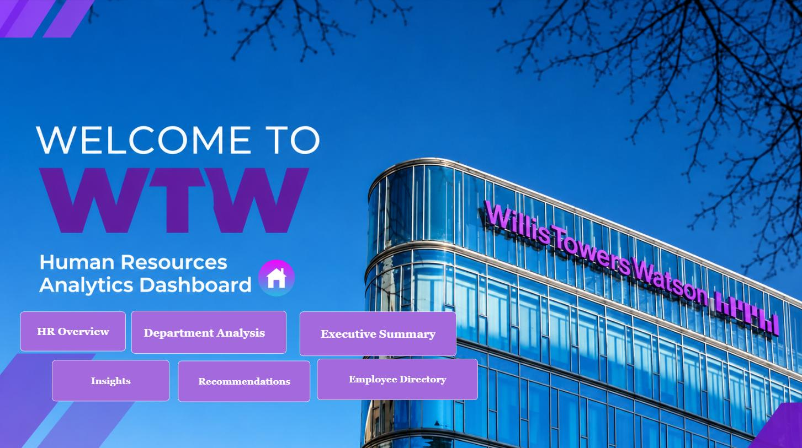
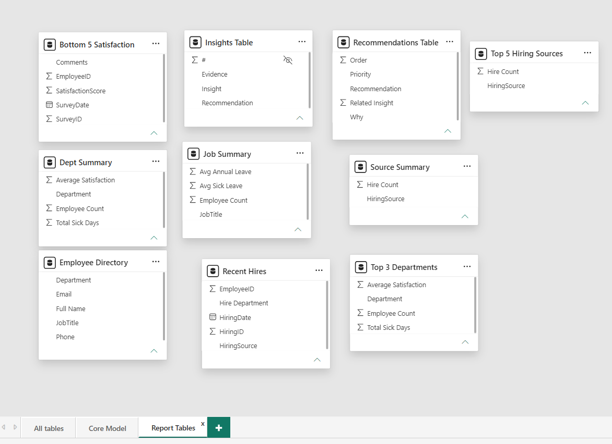
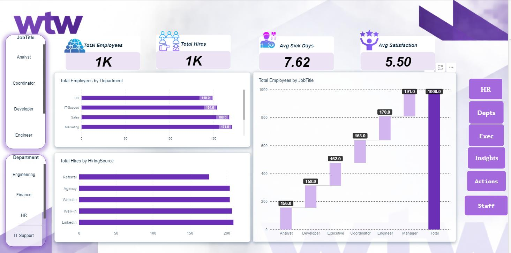
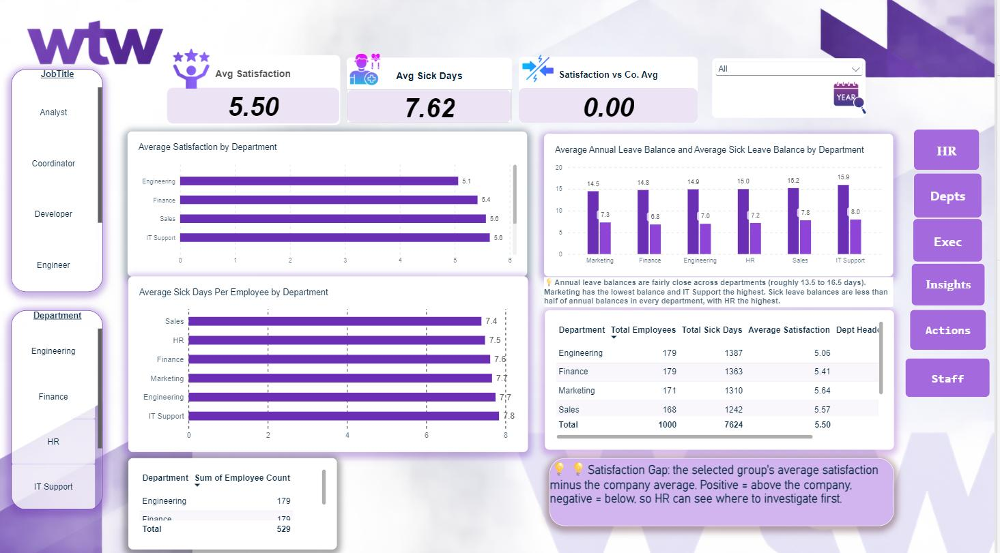
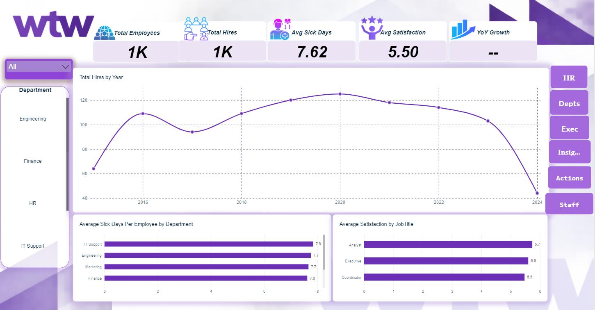

# HR Analytics Dashboard (Power BI)

**Where should HR act first?** A 7-page Power BI report that takes raw HR data to a prioritized list of recommendations.

## Business problem

HR leaders need one reliable view of workforce size, hiring, satisfaction and sick leave, so they know where to act first instead of reacting to scattered reports.

**Questions answered**

1. How large is the workforce, and how is hiring changing?
2. Which departments have the lowest satisfaction?
3. Are sick days a problem in any department?
4. Which hiring sources bring the most hires?
5. Where should HR intervene first?

## Data preparation (Power Query)

- Removed duplicates and verified that `EmployeeID` is unique, so headcount and relationships are reliable.
- Fixed data types for dates, numbers and text.
- Handled missing and inconsistent values.
- Standardized phone numbers: removed spaces, dashes and brackets, and unified the country code.

## Data model

- `Employees` is the central table. `Hiring`, `Balances` and `Satisfaction` are one record per employee (one-to-one).
- `SickLeaves` is one-to-many, because an employee can have several leaves.
- `DimDate` adds year, quarter and month for time analysis.

## DAX

| Measures | Columns and ranking | Calculated tables |
|---|---|---|
| Total Employees, Total Hires | Full Name | Dept Summary, Job Summary |
| Avg Sick Days per Employee (fair across department sizes) | Hire Department, Leave JobTitle | Source Summary, Recent Hires |
| Satisfaction vs Company Avg (group minus company average) | Dept Headcount Rank, Job Satisfaction Rank (`RANKX`) | Top 3 Departments, Top 5 Hiring Sources, Bottom 5 Satisfaction |
| Hires YoY Growth % | | |

## Report pages

Home (navigation) · HR Overview · Department Analysis · Executive Summary · Insights · Recommendations

| HR Overview | Department Analysis | Executive Summary |
|---|---|---|
|  |  |  |

## Key insights

| # | Insight | Evidence | So what |
|---|---|---|---|
| 1 | Engineering: lowest satisfaction, one of the largest teams | 5.06 vs 5.50 company average · 179 employees | Biggest impact |
| 2 | Finance: second-lowest satisfaction | 5.41 · gap about 0.09 | Small gap, monitor |
| 3 | Hiring peaked around 2020, then declined | About 125 in 2020, 44 in 2024 | Unconfirmed: 2024 may be partial |
| 4 | Referral is the lowest hiring source | About 176 vs 203 to 208 | Volume, not quality |
| 5 | HR has the highest satisfaction | 5.77 · 149 employees | Possible model, small team |
| 6 | Sick days are similar across departments | 7.4 to 7.8 per employee | No action needed |

## Recommendations by priority

| Priority | Recommendation | Why |
|---|---|---|
| High | Run a survey and interviews in Engineering | Largest gap and a large headcount |
| Medium | Monitor Finance satisfaction | Small gap, but a large team |
| Medium | Review the hiring plan after confirming 2024 data | The decline may be due to partial data |
| Low | Evaluate candidate quality by source | Count does not equal quality |
| Low | Review HR practices as a possible model | Highest satisfaction, small team |
| Low | No department-specific sick leave policy | Differences are small |

**Conclusion:** investigate Engineering first; treat the rest as monitoring items.

## Limitations

- 2024 data may be incomplete, so the hiring drop is not confirmed.
- Sick-day differences are small and should not be over-interpreted.
- The data shows volume (hiring sources) and scores (satisfaction), not the causes behind them.

## Files

- `HR_Analytics_Dashboard.pbix`: the Power BI report
- `HR_Analytics_Presentation.pdf`: project walkthrough, from business problem to recommendations

Independent portfolio project using a sample dataset. Not affiliated with any company shown.

## Author

**Omar Saad Abu Al-Khair**, Data Analyst · [LinkedIn](https://www.linkedin.com/in/omar-abualkhair) · [Portfolio](https://omar-abualkhair.github.io)
